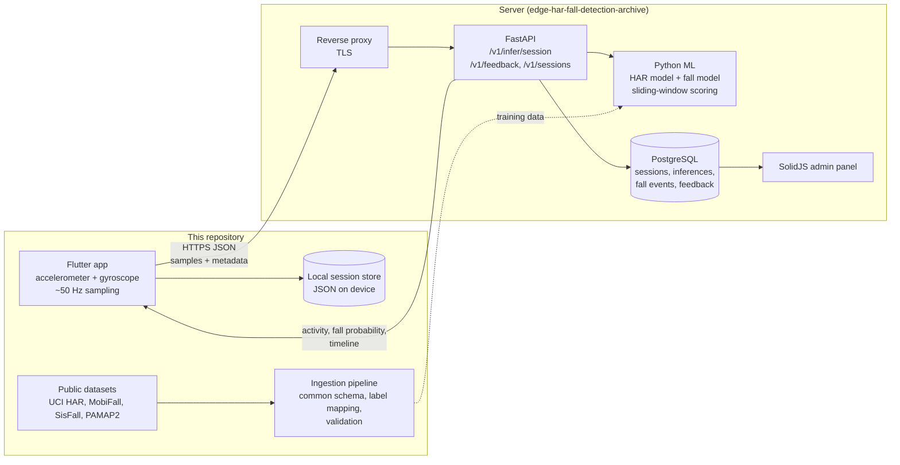
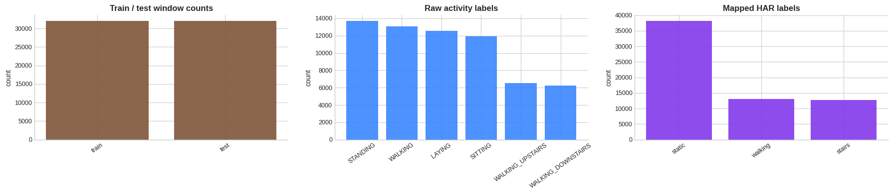

# Fall Monitor: smartphone fall detection and human activity recognition

A phone app that records accelerometer and gyroscope data, sends it to a server for
classification, and shows the person's activity (static, walking, stairs) and whether a fall
was likely. Built as my BSc Computer Science dissertation at Newman University, Birmingham
(graduated 2026, First Class Honours).

This repository holds the **Flutter mobile app**, the **dataset ingestion scaffolding**
(a shared schema, label mapping and validation for public HAR and fall datasets), the
**exploration notebooks** and the **system architecture diagram**. The server side (FastAPI
inference service, PostgreSQL schema, trained models, SolidJS admin panel and Docker setup)
lives in the companion repository
[joelshore4747/edge-har-fall-detection-archive](https://github.com/joelshore4747/edge-har-fall-detection-archive).

## The problem

Falls are a leading cause of injury for older people and for anyone working or walking alone,
and the person who falls often can't call for help. Most people already carry a phone with an
accelerometer and gyroscope, so the question for the dissertation was: can a normal phone,
carried normally, tell everyday movement apart from a fall well enough to be useful, and what
gets in the way?

Two tasks run side by side:

- **Human activity recognition (HAR):** classify short windows of motion as `static`,
  `walking`, `stairs` or `other`.
- **Fall detection:** score each window for fall likelihood and group high-scoring windows into
  fall events.

## Architecture



A more detailed version of this diagram, including the database tables and the admin routes,
is in [`diagrams/unifall-system-architecture.html`](diagrams/unifall-system-architecture.html)
(open it in a browser).

### Mobile app (`apps/mobile/app_mobile`)

Flutter, targeting Android and iOS. The main pieces are in `lib/`:

| File | What it does |
| --- | --- |
| `services/sensor_recorder.dart` | Reads accelerometer and gyroscope streams through `sensors_plus` at a 20 ms period (about 50 Hz) and pairs each accelerometer reading with the latest gyroscope reading (dropped if older than 250 ms). |
| `services/session_storage_service.dart` | Saves recordings as JSON in the app's documents folder, so sessions can be recorded offline and sent later. |
| `services/runtime_api_service.dart` | Client for the inference API: `POST /v1/infer/session` (needs at least 32 samples), `POST /v1/feedback`, `GET /v1/sessions`, `/v1/auth/register` and `/v1/auth/me`. Uses HTTP Basic auth. |
| `services/runtime_identity_service.dart` | Creates and stores the device's account and subject ID. |
| `pages/runtime_home_page.dart` | Recording screen. While recording, it sends the recent window to the API every 3 seconds as a `debug` request (not saved on the server) to show live activity and fall chips. |
| `pages/session_detail_page.dart` | Result view for a session: top activity, fall probability, grouped fall events, timeline and transitions. The user can mark a result as **confirmed fall**, **false alarm** or **uncertain**, which is sent back as feedback for later evaluation. |

Each session records where the phone was carried (pocket, hand, bag or on a desk) and an
activity label, so results can be compared by placement.

### Ingestion pipeline (`pipeline/`, `data/`)

Each public dataset uses different units, sampling rates, sensor placements and label names.
The pipeline maps them all onto one row-level schema so they can be combined:

- `pipeline/schema.py` defines 17 common columns (`dataset_name`, `task_type`, `subject_id`,
  `session_id`, `timestamp`, `ax`/`ay`/`az`, `gx`/`gy`/`gz`, `label_raw`, `label_mapped`,
  `placement`, `sampling_rate_hz`, ...). Gyroscope columns may be empty, because some datasets
  are accelerometer-only.
- `pipeline/ingest/common.py` maps raw labels to the project's classes. For example
  `WALKING_UPSTAIRS` becomes `stairs`, `LAYING` becomes `static`, and any SisFall/MobiFall
  label containing "fall" becomes `fall`.
- `pipeline/validation.py` checks a dataframe before it is used: required columns present, no
  empty labels, numeric sensor values, and warnings for mostly-missing gyroscope data or
  pre-windowed sources.
- `data/uci_har.py`, `data/mobiact_load.py` and `data/sis_fall.py` download the datasets from
  Kaggle mirrors with `kagglehub` into `data/raw/` (which is git-ignored).
  [`data/notes.md`](data/notes.md) lists every dataset and source.

The weather and elevation scripts in `data/` (Open-Meteo, Meteostat) were for an early idea of
adding mountain-environment context. The final system doesn't use them.

### Exploration notebooks (`analysis/`)

One notebook per dataset. Two of them (UCI HAR, SisFall) still have their outputs saved. This
is the UCI HAR label balance from `01_uci_har_visualisation.ipynb`, run on a 250-window
sample per split (64,000 rows at 50 Hz):



After mapping, `static` (standing, sitting, lying) makes up about 60% of the rows. That class
imbalance is one reason accuracy alone is a weak measure for this problem.

The notebooks import dataset loaders (`pipeline.ingest.load_uci_har` and others) that are not
in this repository, so they can't be re-run from here. The loaders are in the archive
repository.

## Results and limitations

The dissertation evaluated the full system on about 100 sessions I recorded myself with the
app. Overall accuracy was **about 60%**, and it was strongest with the phone held in the hand.
A likely reason is that a phone in a pocket or bag moves and rotates against the body in ways
the training data doesn't cover.

That figure comes from the dissertation write-up. This repository doesn't contain the trained
models or the recorded sessions, so it can't be reproduced from here.

The main limits, which are also what I'd tell an interviewer:

- **Small, self-collected dataset.** About 100 sessions isn't enough to train or fairly
  evaluate a model, and sessions I recorded myself won't generalise to other people, phones
  or ways of carrying a phone.
- **No real falls.** Falls can only be simulated safely, and a simulated fall is not the same
  signal as a real one.
- **Domain gap.** The public datasets use waist- or belt-mounted sensors at fixed rates. A
  phone in a pocket is a different signal, so models trained on public data lose accuracy on
  app data.
- **Placement matters.** Results were best with the phone in the hand. A real product would
  need to detect placement or be trained on every placement.
- **Server dependency.** Classification runs on the server, so the app needs a network
  connection to get results. Recording itself works offline.

## Tests

```bash
python -m venv .venv && source .venv/bin/activate
pip install pandas numpy pytest
python -m pytest
```

Result on this commit: **8 passed, 2 failed** (10 tests, `tests/`).

The two failures are in `tests/test_label_mapping.py`. They expect `walking` to map to
`locomotion`, but the mapping in `pipeline/ingest/common.py` returns `walking`. The class was
renamed in the code and the tests weren't updated. The schema tests and the fall-label tests
pass.

The Flutter app has one smoke test (`test/widget_test.dart`, which checks that the app widget
can be built). Run it with `flutter test` from `apps/mobile/app_mobile`.

## Running the mobile app

You need the Flutter SDK (Dart `^3.11.4`) and a running instance of the backend from the
[archive repository](https://github.com/joelshore4747/edge-har-fall-detection-archive).

```bash
cd apps/mobile/app_mobile
flutter pub get
flutter run --dart-define=API_BASE_URL=http://<your-server>:8000
```

`API_BASE_URL` defaults to `http://127.0.0.1:8000`. On first launch the app asks you to sign
up or sign in against that server. Sensor recording needs a real phone, because emulators don't produce useful motion
data.

## Repository layout

```
apps/mobile/app_mobile/   Flutter app (lib/, android/, ios/)
pipeline/                 Common schema, label mapping, validation
data/                     Dataset download scripts and dataset register (notes.md)
analysis/                 Per-dataset exploration notebooks
diagrams/                 System architecture diagram (HTML)
tests/                    pytest suite for the pipeline
docs/images/              README images
```

`apps/api`, `db`, `models`, `services`, `fusion`, `metrics` and `artifacts` are empty
placeholders here. The code for those parts is in the archive repository.

## What I'd improve

- **Train and evaluate on more public data.** Use the full UCI HAR, MobiFall/MobiAct, SisFall
  and PAMAP2 sets through the shared schema, and report per-class precision and recall
  instead of one accuracy number.
- **Collect more app data from more people,** with different phones and placements, and use
  the in-app feedback (confirmed fall / false alarm) as labels.
- **Run a small model on the phone** so detection works without a network and alerts
  don't wait for a round trip to the server.
- **Better hosting.** The prototype ran on a single VPS. A managed database, health checks
  and monitoring would make it reliable enough for longer trials.
- **Fix the repository hygiene items:** the two failing label tests, the leftover template
  project at `apps/mobile/app_mobile/app_mobile/`, and the loaders the notebooks need.

---

This README was written with the help of Claude Code, working from the code, notebooks and
test results in this repository.
